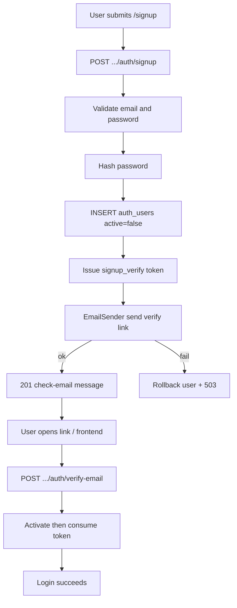
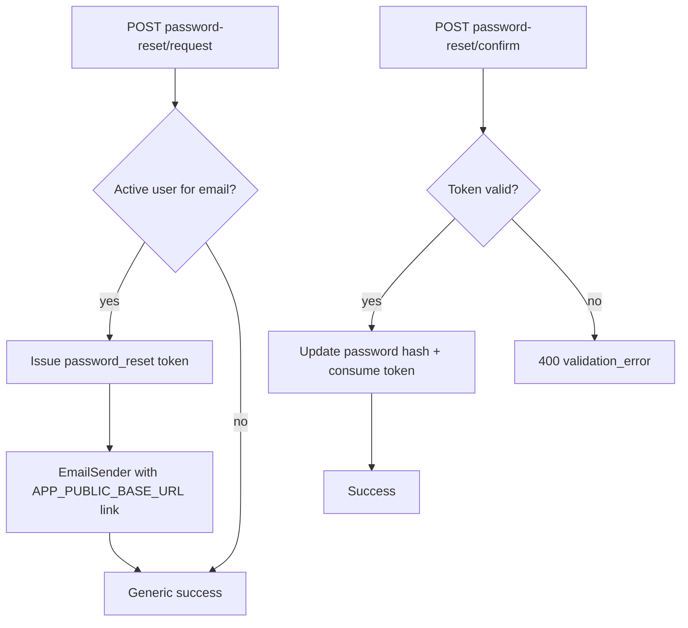

# API reference (agents)

Parent hub: [../../AGENTS.md](../../AGENTS.md). Routing diagrams: [../architecture.md](../architecture.md#http-routing).

## Endpoints

| Endpoint | Notes |
|----------|--------|
| `GET /api/health` | Returns `"up"` |
| `GET /api/version` | Build/git revision string |
| `POST /life-manager/api/v1/auth/login` | JWT login |
| `POST /life-manager/api/v1/auth/signup` | Create inactive user (email stored as `username`); issues `signup_verify` token; sends verify email via `EmailSender` with `{APP_PUBLIC_BASE_URL}/verify-email?token=...`; returns check-email message; no JWT. Send failure after insert rolls back the user and returns `503 service_unavailable`. |
| `POST /life-manager/api/v1/auth/verify-email` | Body `{ token }`. Sets `active=true` for a valid `signup_verify` token, then consumes it; returns success message; **no JWT**. Invalid/expired/used → `400 validation_error`. Server fault → `500`. |
| `POST /life-manager/api/v1/auth/password-reset/request` | Request password reset `{ email }`; always same generic success; mail only for active users (`APP_PUBLIC_BASE_URL` link) |
| `POST /life-manager/api/v1/auth/password-reset/confirm` | Confirm reset `{ token, new_password }`; updates hash; consumes one-time token |
| `GET /life-manager/api/v1/auth/protected` | Auth smoke test |
| `POST /test-tenant/api/v1/auth/login` | JWT login (test-tenant pilot) |
| `POST /test-tenant/api/v1/auth/signup` | Create inactive user (test-tenant pilot); same verify-email flow as life-manager |
| `POST /test-tenant/api/v1/auth/verify-email` | Same as life-manager verify-email (test-tenant pilot) |
| `POST /test-tenant/api/v1/auth/password-reset/request` | Password-reset request (test-tenant pilot) |
| `POST /test-tenant/api/v1/auth/password-reset/confirm` | Password-reset confirm (test-tenant pilot) |
| `GET /test-tenant/api/v1/auth/protected` | Auth smoke test (test-tenant pilot) |
| `POST /life-manager/api/v1/documents/` | Multipart: `json` (CreateDocumentCommand) + `file` |
| `POST /life-manager/api/v1/documents/json` | JSON body: CreateDocumentCommand with required `storage` (Proton Drive ref); no file/OCR — see [Proton upload workflow](../development_faq.md#upload-workflow) |
| `GET /life-manager/api/v1/documents/{id}` | Single document (owner only; other users receive 404) |
| `DELETE /life-manager/api/v1/documents/{id}` | Hard-delete owned document (204); other users / missing → 404. Proton Drive trash is client-side before this call when `storage` exists — see [delete workflow](../development_faq.md#delete-workflow) |
| `GET /life-manager/api/v1/documents/` | List owned docs. `title` = keyset cursor (`title >` value). `title_contains` = case-insensitive substring on title. |
| `PUT /life-manager/api/v1/documents/json/{id}` | JSON body: UpdateDocumentCommand; optional `storage` replaces Proton ref; `storage: null` keeps existing |
| `PUT /life-manager/api/v1/documents/{id}` | Multipart: `json` (UpdateDocumentCommand) + optional `file` (OCR on native) |
| `POST /life-manager/api/v1/health-members` | JSON: CreateHealthMemberCommand (`display_name` required, trimmed, max 100; optional `birth_date` YYYY-MM-DD, not future; optional `notes` max 2000). Creates `active=true`. JWT. No hard-delete in MVP. |
| `GET /life-manager/api/v1/health-members` | List owned HealthMembers. Query `include_inactive=true` to include deactivated (default false = active only). |
| `GET /life-manager/api/v1/health-members/{id}` | Single HealthMember (owner only; other users / missing → 404). Inactive still returned for owner. |
| `PUT /life-manager/api/v1/health-members/{id}` | JSON: UpdateHealthMemberCommand — `display_name` required. `birth_date` / `notes`: omit = keep, `null` = clear, value = set. Optional `active` for reactivate (`true`) or deactivate (`false`). Prefer POST deactivate for deactivate. Limits are Unicode characters (name max 100, notes max 2000). |
| `POST /life-manager/api/v1/health-members/{id}/deactivate` | Soft-deactivate (idempotent). Sets `active=false` and `deactivated_at`. Row remains; GET by id still works for owner. No hard-delete. |
| `POST /life-manager/api/v1/health-readings` | JSON: CreateHealthReadingCommand (`health_member_id`, `recorded_on` YYYY-MM-DD required, not future; optional **metric** vitals only — `height_cm`, `weight_kg`, `systolic_mm_hg`, `diastolic_mm_hg`, `heart_rate_bpm`, `notes` max 2000). No imperial fields. At least one metric or notes. Duplicate `(health_member_id, recorded_on)` → 400. Inactive member → 400. Other user's member → 404. JWT. Response includes optional computed `bmi` (not stored). |
| `GET /life-manager/api/v1/health-readings` | List readings for one owned HealthMember. Query `health_member_id` required. Optional inclusive `from` / `to` (YYYY-MM-DD); `from` > `to` → 400. Newest `recorded_on` first. MVP returns all matching rows (unbounded). |
| `PUT /life-manager/api/v1/health-readings/{id}` | JSON: UpdateHealthReadingCommand — replace mutable **metric** fields (`recorded_on` required, not future; optional vitals same as create, `notes` max 2000). `health_member_id` is immutable. At least one metric or notes. Changing `recorded_on` onto another reading's date for that member → 400. Missing / other user's id → 404. JWT. Does not require the member to be active. |
| `DELETE /life-manager/api/v1/health-readings/{id}` | Hard-delete owned reading (204). Missing / other user's id → 404. Delete twice → second 404. JWT. |
| `POST /life-manager/api/v1/doctor-visits` | JSON: CreateDoctorVisitCommand (`health_member_id`, `visited_on` YYYY-MM-DD required, not future; optional `provider_name` max 100, `reason` max 2000, `notes` max 2000). Text is trimmed. Blank becomes null. At least one of `provider_name`, `reason`, `notes` is required. Many visits on the same day are allowed. Inactive member → 400. Other user's member → 404. JWT. |
| `GET /life-manager/api/v1/doctor-visits` | List visits for one owned HealthMember. Query `health_member_id` required (missing → 400). Optional inclusive `from` / `to` (YYYY-MM-DD) on `visited_on`; `from` > `to` → 400. Newest `visited_on` first. MVP returns all matching rows (unbounded). |
| `GET /life-manager/api/v1/doctor-visits/{id}` | Single owned visit. Missing / other user's id → 404. JWT. |
| `PUT /life-manager/api/v1/doctor-visits/{id}` | JSON: UpdateDoctorVisitCommand — replace `visited_on` (required, not future) and optional text fields. Same validation as create. `health_member_id` is immutable. Inactive member → 400 (update checks the member, unlike health-readings). Missing / other user's id → 404. JWT. |
| `DELETE /life-manager/api/v1/doctor-visits/{id}` | Hard-delete owned visit (204). Allowed when the member is inactive. Missing / other user's id → 404. Delete twice → second 404. JWT. |
| `POST /life-manager/api/v1/cars` | JSON: CreateCarCommand (`make`, `model`, `year` required; optional `display_name`, `vin`, `license_plate`, `notes`, `insurance_document_id`, `registration_document_id`). Creates `active=true`. VIN when set: 17 chars A-HJ-NPR-Z0-9 (uppercased). License plate trimmed/uppercased. Year 1900–current+1. Duplicate VIN or plate for same user → 400. Document ids must be owned Documents. JWT. |
| `GET /life-manager/api/v1/cars` | List owned Cars. Query `include_inactive=true` to include deactivated (default false = active only). |
| `GET /life-manager/api/v1/cars/{id}` | Single Car (owner only; other users / missing → 404). Inactive still returned for owner. |
| `PUT /life-manager/api/v1/cars/{id}` | JSON: UpdateCarCommand — `make`, `model`, `year` required. Optional fields (`display_name`, `vin`, `license_plate`, `notes`, document ids): omit = keep, `null` = clear, value = set. Optional `active` for reactivate (`true`) or deactivate (`false`). Prefer POST deactivate for deactivate. Same VIN/plate uniqueness and Document ownership rules as create. |
| `POST /life-manager/api/v1/cars/{id}/deactivate` | Soft-deactivate (idempotent). Sets `active=false` and `deactivated_at`. Row remains; GET by id still works for owner. |
| `DELETE /life-manager/api/v1/cars/{id}` | Hard-delete owned Car (204). Cascades owned `CarMaintenanceEvent` rows (`ON DELETE CASCADE`). Missing / other user's id → 404. Delete twice → second 404. JWT. |
| `POST /life-manager/api/v1/car-maintenance-events` | JSON: CreateCarMaintenanceEventCommand (`car_id`, `occurred_on` YYYY-MM-DD required, not future; `event_type` one of `oil_change`, `tire`, `brakes`, `service`, `repair`, `other`; optional `odometer_miles` >= 0, `cost_cents` >= 0, `title` max 100, `notes` max 2000, `document_id`). At least one of title, notes, odometer_miles, or cost_cents. Inactive Car → 400. Missing / other user's Car → 404. `document_id` must be an owned Document when set. JWT. |
| `GET /life-manager/api/v1/car-maintenance-events` | List events for one owned Car. Query `car_id` required (missing → 400). Optional inclusive `from` / `to` (YYYY-MM-DD) on `occurred_on`; `from` > `to` → 400. Optional `event_type` filter (invalid → 400). Newest `occurred_on` first. MVP returns all matching rows (unbounded). |
| `GET /life-manager/api/v1/car-maintenance-events/{id}` | Single owned event. Missing / other user's id → 404. JWT. |
| `PUT /life-manager/api/v1/car-maintenance-events/{id}` | JSON: UpdateCarMaintenanceEventCommand — replace mutable fields (`occurred_on` required, not future; `event_type` same enum as create; optional `odometer_miles` >= 0, `cost_cents` >= 0, `title` max 100, `notes` max 2000, `document_id`). At least one of title, notes, odometer_miles, or cost_cents. `car_id` is immutable and not accepted in the body. Update on inactive Car is allowed (history correction). `document_id` must be an owned Document when set. Missing / other user's id → 404. JWT. |
| `DELETE /life-manager/api/v1/car-maintenance-events/{id}` | Hard-delete owned event (204). Allowed when the Car is inactive. Missing / other user's id → 404. Delete twice → second 404. JWT. |

**Car ownership**

- Auth user owns `Car` (`user_id`). Document links store UUID refs only; application verifies owned Documents when set.
- VIN and license_plate uniqueness are per user when non-empty. Different users may share the same VIN or plate.
- Inactive cars stay queryable by id for the owner. List excludes inactive by default.
- Auth user owns `CarMaintenanceEvent` (`user_id` copied from Car on create). Create rejects inactive Cars. Update and delete stay allowed on inactive Cars. Optional `document_id` is a UUID ref; ownership is checked in the application layer on create and update.
- Hard-delete of a Car removes its maintenance events via FK cascade. Document rows stay; only UUID refs on the Car/event are removed with those rows.
- UI: manage Cars, maintenance history, and charts on the Car Manager screen (`CarScreen`), not on Home/Documents.

**Health ownership and units**

- Auth user owns `HealthMember` (`user_id`). Readings and visits store `HealthMemberId` (plus denormalized `user_id` for auth). Call `HealthMember::ensure_active_for_write` before **creating** readings and before **creating or updating** doctor visits. Reading updates do not require an active member.
- Health does **not** share Document storage or Proton Drive refs.
- API vitals are **metric only**. UI imperial conversion is client-side (`frontend/lib/health/units.ts`); do not document or accept imperial fields on the backend API.
- UI: create/update/deactivate HealthMembers and manage doctor visits on the Health Manager screen (`HealthScreen`), not on Home/Documents.

Proton-backed file **preview, download, and trash** are client → Proton Drive only (web). There is no `GET .../documents/{id}/file` (or similar) on this API; see [Proton preview/download](../development_faq.md#preview-and-download-workflow) and [delete workflow](../development_faq.md#delete-workflow).

Ops endpoints stay at `/api/*`. The v1 product API is namespaced under `/life-manager/api/v1/*`.

### Router wiring

- `backend/src/lib.rs`: stateless `/api/health`, `/api/version`; `LifeManagerTenant::mount()` and `TestTenant::mount()` nest `/life-manager` and `/test-tenant` with per-tenant state
- `backend/libs/life-manager/src/life_manager_tenant.rs`: `LifeManagerTenant` implements `TenantMount`; `api_router()` nests `/api/v1` → `auth`, `documents`, `health-members`, `health-readings`, `doctor-visits`, `cars`, `car-maintenance-events`
- `backend/libs/test-tenant/src/test_tenant.rs`: `TestTenant` implements `TenantMount`; `api_router()` nests `/api/v1` → `auth` only (pilot)
- `backend/libs/common/server-host/`: `AppBootstrap` (build-time only) and `TenantMount` trait

### Gateway (prod)

Nginx proxies each tenant hostname to its mount path (see `nginx/tenants.prod.json` and `nginx/generated/tenant-servers.conf.template`) plus `/api` (health/version) to the backend. See `nginx/README.md`.

## Auth

- Protected routes: `Authorization: Bearer <token>`
- Login rejects unknown credentials, inactive users (`active = false`), and principals whose `tenant` does not match the tenant mount (e.g. `life-manager`)
- Signup (`POST .../auth/signup`) accepts `{ email, password }`, stores the email in `auth_users.username`, inserts with `active = false`, issues a `signup_verify` token, and sends email via `EmailSender` with link `{APP_PUBLIC_BASE_URL}/verify-email?token=...`. Returns `201` with a check-email message (no JWT). Duplicate email → `400 validation_error`. If send fails after insert, the user (and tokens) are rolled back and the API returns `503 service_unavailable`.
- Verify (`POST .../auth/verify-email`) accepts `{ token }`, sets `active = true` for a valid `signup_verify` token, then consumes the token, and returns a success message (**no JWT**). Invalid, expired, or reused token → `400 validation_error` and activates no user. Server faults → `500 internal_error`.
- Password reset request (`POST .../auth/password-reset/request`) accepts `{ email }` and always returns the same generic success message. Mail is sent only when an **active** user exists for that email on the tenant mount. Unknown, inactive, or wrong-tenant emails get the same success with no mail. Link path: `{APP_PUBLIC_BASE_URL}/reset-password?token=...` (do not hard-code the origin).
- Password reset confirm (`POST .../auth/password-reset/confirm`) accepts `{ token, new_password }` (min length same as signup). A valid `password_reset` token for a still-active user updates the password hash, consumes the token, and leaves `active` unchanged. Bad, expired, wrong-tenant, or inactive-user tokens return `400 validation_error` and do not change the hash.





- **Ops escape hatch:** manual SQLite activation may still activate a pending user (agents do not run write SQL):

```bash
# Dev DB path from .dev.env
sqlite3 ./data/dev-test.db \
  "UPDATE auth_users SET active = 1 WHERE username = 'user@example.com';"
```

List pending signups:

```sql
SELECT username, tenant, created_at FROM auth_users WHERE active = 0;
```

- Backend auth crate: `backend/libs/auth/` builds `AuthState` via `AuthStateBuilder`; life-manager composes it into `LifeManagerState` and wires `FromRef` via `libs/life-manager/src/infrastructure/auth_integration.rs`
- Handlers receive `AuthUser` where required
- Frontend: `useAuth()` + `authenticatedFetch` from `frontend/lib/api/client.ts` — do not hard-code origins in components
- Frontend email flows (unauthenticated): `frontend/lib/auth/email-flows.ts` calls `POST .../auth/verify-email`, `.../password-reset/request`, and `.../password-reset/confirm`. Screens: `/verify-email`, `/forgot-password`, `/reset-password` (#219)

## Multipart document create

See [../development_faq.md](../development_faq.md) for Postman/examples.

## Frontend API base URL

Override order (`frontend/constants/config.ts`, `app.config.ts`):

1. `EXPO_PUBLIC_API_BASE_URL`
2. Expo `extra.apiUrl`

- **Dev:** usually `http://localhost:3000` (or host reachable from device/emulator)
- **Prod:** same origin as **gateway** — see [../../README.md](../../README.md)

### Frontend path convention

Import `apiV1` from `@/lib/api/client`. Example: `apiV1('/documents')` — do not hard-code `/api/v1` or `/life-manager` in components. The v1 prefix is set at runtime from the active tenant (`TenantProvider` → `configureApiClient`).

**Tenant resolution (frontend):** hostname or env maps to a tenant module in `frontend/lib/tenant/registry.ts`, which supplies `apiV1Prefix` (e.g. `/life-manager/api/v1`). This is separate from nginx routing but must stay aligned with backend `TenantMount::MOUNT_PATH`. Dev options: [../development_faq.md](../development_faq.md#multi-tenant-frontend-dev).

Device/emulator notes: [../development_faq.md](../development_faq.md).

### TypeScript DTOs

Request/response types for the v1 API are generated from Rust (`ts-rs`) into `frontend/lib/api/generated/`. Import via `@/lib/api/types`. Regenerate with `./backend/scripts/export_ts_bindings.sh` when backend DTOs change.
